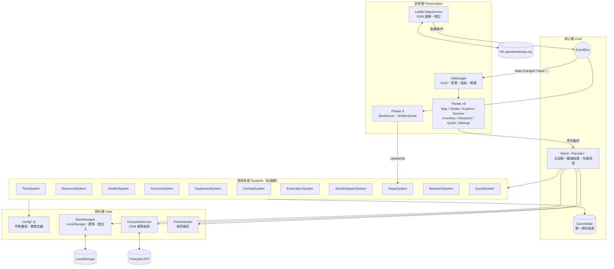
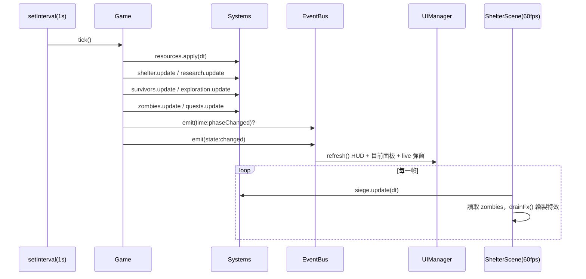
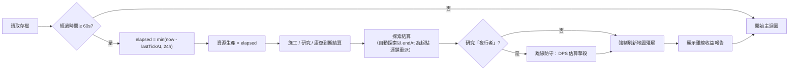

# 第二階段：系統架構

## 1. 分層架構

### 設計原則
| 原則 | 實作 |
|---|---|
| **單一資料來源** | 所有可存檔的資料都在 `game.state`（純 JSON），系統只讀寫 state，不自行保存副本。 |
| **邏輯與呈現分離** | `systems/` 不依賴 DOM / Phaser，可在 Node 中執行（`npm run check`）。 |
| **資料驅動** | 數值與內容集中在 `config/`，新增建築/敵人/研究/任務不需改系統程式。 |
| **鬆耦合** | 呈現層之間以 `EventBus` 溝通；UI 只透過 `Game` facade 存取邏輯。 |
| **操作結果統一** | 所有玩家動作回傳 `{ ok, msg?, reason? }`，由 `UIManager.result()` 統一提示。 |

## 2. 主迴圈與時間

- **邏輯迴圈**（1 秒）與**渲染迴圈**（Phaser 60fps）分離；屍潮防守因需要平滑動畫而在渲染迴圈中推進。
- 若分頁被背景節流超過 60 秒，下一次 tick 自動以「靜默離線模式」結算。

## 3. 離線結算流程

## 4. 模組職責

| 模組 | 職責 | 主要 API |
|---|---|---|
| `core/Game` | 組合所有系統、主迴圈、離線、存檔、地圖掃描 | `start() tick() processOffline() scanMap() grant() log() toast() save()` |
| `core/EventBus` | 發佈/訂閱 | `on() once() off() emit()` |
| `core/GameState` | 新存檔結構工廠 | `createInitialState() createSurvivor()` |
| `core/SaveManager` | LocalStorage、版本遷移、Base64 匯出入 | `load() save() migrate() exportString() importString()` |
| `TimeSystem` | 日夜時段（由建檔時間推導） | `day() hour() phase() exploreSpeedMul()` |
| `ResourceSystem` | 產出/消耗速率、套用、上限 | `rates() apply(dt) storageCap()` |
| `ShelterSystem` | 選址、設施、防禦建築、施工佇列、圍牆 | `setShelter() upgradeFacility() buildDefense() garrison()` |
| `SurvivorSystem` | 屬性計算、經驗、技能、招募、受傷、工作 | `stats() gainXp() injure() recruitRandom() setJob()` |
| `EquipmentSystem` | 隨機生成、詞綴、穿脫、出售、拆解、製作 | `generate() equip() sell() dismantle() craft()` |
| `CombatSystem` | 自動戰鬥模擬、結果套用 | `createEnemy() simulate() applyOutcome()` |
| `ExplorationSystem` | 派遣、時間計算、事件結算、自動探索 | `start() update() resolve() recall()` |
| `ZombieSpawnSystem` | 地圖殭屍群刷新、區域危險度、攻擊 | `refresh() areaDanger() attack()` |
| `SiegeSystem` | 屍潮即時模擬（世界座標）、離線防守 | `update(dt) drainFx() defenseDps() simulateOffline()` |
| `ResearchSystem` | 研究條件、進度、效果彙總（快取） | `start() bonuses() hasUnlock()` |
| `QuestSystem` | 主線/每日/成就條件與領獎 | `progress() claimMain() claimDaily() claimAchievement()` |
| `map/OverpassService` | 組 Overpass QL、多端點容錯、OSM 標籤分類 | `fetchPois() classify()` |
| `map/PoiGenerator` | 缺類型時程序生成地點 | `fillPois()` |
| `map/MapService` | Leaflet 地圖、圖層、標記 | `init() render() focus()` |
| `scenes/ShelterScene` | 避難所俯視場景渲染 | — |
| `ui/UIManager` | 版面、分頁、HUD、徽章、Phaser 可視區域 | `switchTab() refresh() result()` |

## 5. 事件一覽

| 事件 | 發送者 | 接收者 | 用途 |
|---|---|---|---|
| `state:changed` | Game.tick / 玩家動作 | UIManager、ShelterScene | 重繪 |
| `ui:toast` | Game.toast | UIManager | 通知 |
| `time:phaseChanged` | Game.tick | （擴充用） | 日夜轉換 |
| `map:changed` | Game.scanMap、ZombieSpawn | MapPanel | 重繪地圖 |
| `expedition:done` | ExplorationSystem | MapPanel | 更新路線 |
| `shelter:changed` | ShelterSystem | ShelterScene | 重繪槽位 |
| `ui:openDefenseSlot` | ShelterScene | ShelterPanel | 點槽位開建造窗 |
| `ui:openPoi` / `ui:openZombie` | MapService | MapPanel | 地圖互動 |
| `siege:breach` | SiegeSystem | （擴充用） | 防線失守 |

## 6. 擴充指引
- **新增敵人**：在 `config/enemies.js` 加一筆，並加入 `poiTypes.js` 的 `enemies` 權重即可。
- **新增防禦塔**：`config/defenses.js` 加定義，於 `SiegeSystem.fire()` 的 `switch` 實作攻擊行為，`ShelterScene` 會自動顯示。
- **新增研究效果**：在 `research.js` 的 `effects` 加 key，於讀取端呼叫 `game.research.bonus('key')`。
- **資料結構變更**：提高 `SAVE_VERSION`，並在 `SaveManager.migrate()` 加入遷移步驟。
