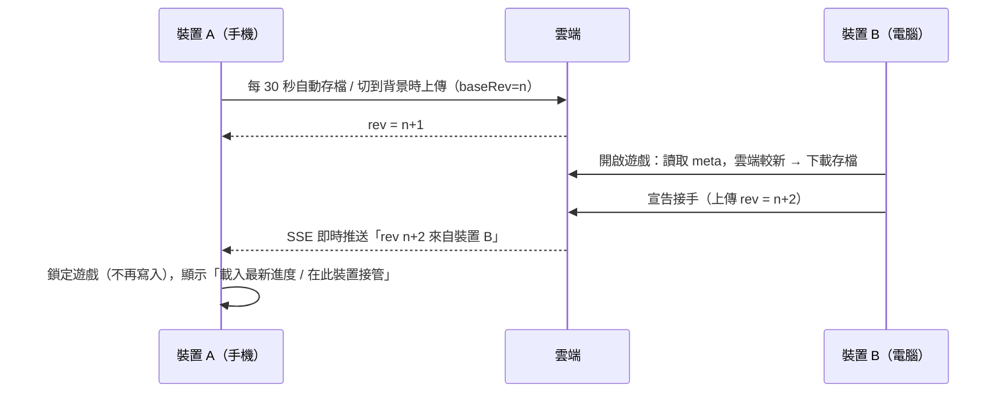

# 帳號與雲端存檔（跨裝置即時接續）

## 玩家使用方式
1. 開啟遊戲 → **✨ 註冊新帳號**（帳號 3～20 個英文小寫／數字／底線，密碼至少 6 個字元，不需 Email）→ 建立角色。
2. 其他裝置開啟遊戲 → **🔑 登入**同一個帳號，立即讀取雲端進度。
3. 此裝置會記住登入狀態，下次開啟直接進入遊戲；**設定 → 🚪 登出**可切換帳號。

> 遊戲進度**只存在雲端帳號**，瀏覽器不保存進度（只記住登入憑證，不含密碼）。密碼不以明碼保存；忘記密碼時由管理員重設（見下方「忘記密碼」）。
> v2.x 以前的本機存檔：在該裝置註冊新帳號時，會詢問是否轉移到帳號。

## 同步機制



| 情境 | 行為 |
|---|---|
| 開啟遊戲 / 登入 | 一律讀取雲端最新進度 |
| 遊戲中，其他裝置開始遊玩 | 即時鎖定本機（SSE；Supabase 為 10 秒輪詢），避免互相覆蓋 |
| 兩台裝置同時寫入 | 樂觀鎖：`baseRev` 不符的寫入被拒（HTTP 409），該裝置被鎖定 |
| 網路斷線（遊戲中） | 照常遊玩；HUD 顯示 ☁️✕，恢復後下一次存檔自動上傳（期間關閉頁面會遺失未上傳的進度） |
| 網路斷線（開啟時） | 無法進入遊戲，可重試或改用其他帳號 |
| 「在此裝置接管」 | 以本機進度強制覆蓋雲端，其他裝置隨即被鎖定 |
| 刪除進度重新開始 | 清空雲端進度（帳號保留），重新建立角色 |

## 後端選擇

### A. 內建伺服器（預設，零相依）
`server/index.js`：Node 18+ 內建模組實作，存檔以 JSON 檔保存，並可同時提供前端靜態檔。

```bash
npm run build
```

```bash
npm run server
```

開啟 <http://localhost:8787> 即可（前端與 API 同網域）。開發時 `npm run dev` 會把 `/api` 代理到 8787，所以另開一個終端機執行 `npm run server` 即可。

| 環境變數 | 預設 | 說明 |
|---|---|---|
| `PORT` | 8787 | 監聽埠 |
| `DATA_DIR` | `server/data` | 存檔目錄（請放在持久化磁碟並定期備份） |
| `STATIC_DIR` | `dist` | 前端靜態檔（存在才提供） |
| `CORS_ORIGIN` | `*` | 前端與 API 不同網域時，填入前端網址 |

前端部署在其他網域（例如 GitHub Pages）時，建置前設定 `VITE_CLOUD_URL=https://你的伺服器`。行動裝置建議全程使用 HTTPS。
可部署到任何能跑 Node 的主機（Render、Railway、Fly.io、VPS）；若使用 Nginx 反向代理，SSE 路徑需關閉緩衝（伺服器已送出 `X-Accel-Buffering: no`）。

### B. Supabase（免自架）
1. 建立 Supabase 專案，在 SQL Editor 執行 [`supabase/schema.sql`](../supabase/schema.sql)。
2. 複製 `.env.example` 為 `.env`：

```
VITE_CLOUD_PROVIDER=supabase
VITE_SUPABASE_URL=https://xxxx.supabase.co
VITE_SUPABASE_ANON_KEY=sb_publishable_...（或舊版 eyJ... anon key）
```

3. `npm run build` 後部署 `dist/` 到任何靜態主機。

資料表啟用 RLS 且無任何 policy，anon key 只能呼叫三個驗證 token 的函式（`jdqs_save_meta / get / put`），無法列舉或讀取他人存檔。

### C. 關閉
`VITE_CLOUD_PROVIDER=none`。

## API（內建伺服器）
| 方法 | 路徑 | 說明 |
|---|---|---|
| GET | `/api/health` | 健康檢查 |
| GET | `/api/saves/:id/meta` | 版本資訊 `{ rev, updatedAt, deviceId, deviceName }` |
| GET | `/api/saves/:id` | 下載存檔 `{ meta, data }` |
| PUT | `/api/saves/:id` | 上傳 `{ baseRev, deviceId, deviceName, data, force? }` → 200 / 409 / 403 |
| GET | `/api/saves/:id/events?token=` | SSE：其他裝置寫入時推送 meta |
| PUT | `/api/world/players/:id` | 多人互動：上傳公開資料 `{ name, civ, bases, trips }`（Bearer = 玩家 token） |
| DELETE | `/api/world/players/:id` | 多人互動：取消公開（Bearer = 玩家 token） |
| GET | `/api/world/nearby?lat=&lon=&km=` | 多人互動：附近玩家（3 天未更新者不列出） |
| POST | `/api/world/players/:id/events` | 送出事件 `{ from, type, data }`（attack／friendRequest／friendAccept／friendRemove；Bearer = 寄件者 token） |
| GET | `/api/world/players/:id/events` | 讀取並清空自己的事件信箱（Bearer = 本人 token） |

驗證：`Authorization: Bearer <token>`。
- `id = sha256("jdqs-acct:" + 帳號)` 取前 32 字元
- `token` = 以 `sha256("jdqs-pw:帳號:密碼")` 為起點，再與密碼反覆 SHA-256 10,000 次

伺服器只會收到雜湊值，看不到密碼本身。註冊＝第一次以 `baseRev=0` 上傳；帳號已存在時密碼不同會被拒（403）。另有每 IP 每分鐘 120 次請求上限、2MB 存檔上限，比對採 timing-safe。

### 忘記密碼（管理員重設）
資料庫只存反覆雜湊後的 token，**不保存明碼密碼**（玩家常在多個網站共用密碼，存明碼一旦外洩影響會擴及其他網站；Publishable 金鑰也是公開的）。因此無法「查詢」原密碼，而是由管理員設定新密碼：

1. 確認提出請求的是帳號本人（例如詢問角色名稱、據點位置等遊戲內資訊）。
2. 在專案目錄執行（帳號、新密碼換成實際值）：
   ```bash
   npm run reset-password -- 玩家帳號 新密碼
   ```
3. 把輸出的 SQL 貼到 Supabase → **SQL Editor** 執行；最後的查詢結果為 1～2 表示成功，0 表示帳號不存在。
4. 把新密碼告訴玩家，請玩家登入後牢記。其他已登入的裝置會因密碼變更而需要重新登入。

存檔、建築清單與公開據點的憑證會一併更新，遊戲進度不受影響。

## 程式結構
| 檔案 | 職責 |
|---|---|
| `src/cloud/CloudSync.js` | 帳號登入／註冊／登出、自動上傳、即時監看、鎖定、接管、重置進度 |
| `src/cloud/account.js` | 帳號密碼格式檢查、id / token 推導 |
| `src/ui/AuthScreen.js` | 首頁登入／註冊畫面 |
| `src/cloud/providers/` | `SelfHostProvider`、`SupabaseProvider`、`createProvider()` |
| `src/utils/sha256.js` | 純 JS SHA-256（非 HTTPS 環境也能用） |
| `server/` | 內建伺服器與檔案儲存 |
| `supabase/schema.sql` | Supabase 資料表與 RPC |
| `scripts/test-cloud.js` | 伺服器 + 客戶端整合測試（`npm run test:cloud`） |

本機只存登入狀態：LocalStorage `jdqs_cloud_v2`（`{ auth: { username, id, token }, rev, deviceId, lastSyncAt }`），不含遊戲進度與密碼。

## 多人互動
多人互動與雲端存檔共用同一個後端：內建伺服器會把資料寫到 `DATA_DIR/world.json`；Supabase 則需執行 `supabase/schema.sql` 中新增的 `jdqs_world` 資料表與 3 個 RPC。
GitHub Pages 版預設 `VITE_CLOUD_PROVIDER=none`，沒有後端時多人互動不會啟用。

v7.0.0 起新增事件信箱：Supabase 需重新執行 `supabase/schema.sql`（新增 `jdqs_world_events` 資料表與 `jdqs_world_send`、`jdqs_world_inbox` 兩個 RPC）。
