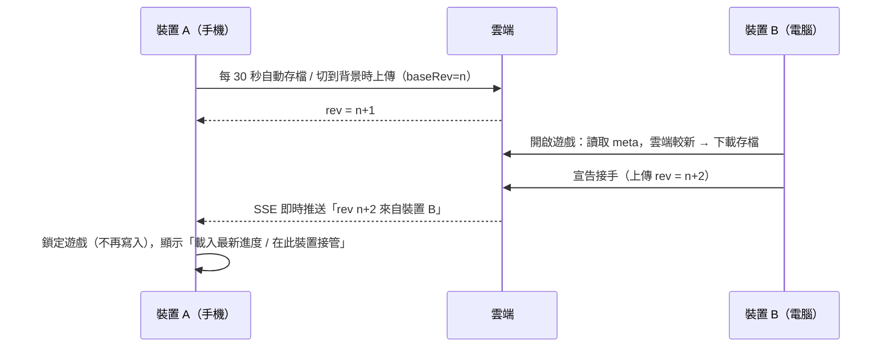

# 雲端存檔（跨裝置即時接續）

## 玩家使用方式
1. 裝置 A：**設定 → 雲端存檔 → ☁️ 啟用雲端存檔**，取得 24 字元的**同步碼**（`XXXX-XXXX-XXXX-XXXX-XXXX-XXXX`）。
2. 裝置 B：首頁點 **☁️ 用同步碼讀取雲端存檔**（已有本機存檔則到 設定 → 🔗 輸入同步碼），即可接續同一份進度。
3. 之後每台裝置開啟遊戲時都會**自動讀取雲端最新存檔**，離線收益依最後一次遊玩時間正確結算。

> 同步碼就是存檔的鑰匙（免註冊帳號），擁有它的人都能讀寫這份存檔，請勿公開。

## 同步機制



| 情境 | 行為 |
|---|---|
| 開啟遊戲，雲端版本較新 | 自動下載雲端存檔 |
| 遊戲中，其他裝置開始遊玩 | 即時鎖定本機（SSE；Supabase 為 10 秒輪詢），避免互相覆蓋 |
| 兩台裝置同時寫入 | 樂觀鎖：`baseRev` 不符的寫入被拒（HTTP 409），該裝置被鎖定 |
| 網路斷線 | 照常遊玩並存在本機；HUD 顯示 ☁️✕，恢復後下一次存檔自動上傳 |
| 「在此裝置接管」 | 以本機進度強制覆蓋雲端，其他裝置隨即被鎖定 |
| 刪除本機存檔 | 同時解除雲端連結（雲端資料保留，可用同步碼重新連結） |

## 後端選擇

### A. 內建伺服器（預設，零相依）
`server/index.js`：Node 18+ 內建模組實作，存檔以 JSON 檔保存，並可同時提供前端靜態檔。

```bash
npm run build
```

```bash
npm run server
```

開啟 <http://localhost:8787> 即可（前端與 API 同網域）。開發時 `npm run dev` 會把 `/api` 代理到 8787，所以另開一個終端機執行 `npm run server` 即可。

| 環境變數 | 預設 | 說明 |
|---|---|---|
| `PORT` | 8787 | 監聽埠 |
| `DATA_DIR` | `server/data` | 存檔目錄（請放在持久化磁碟並定期備份） |
| `STATIC_DIR` | `dist` | 前端靜態檔（存在才提供） |
| `CORS_ORIGIN` | `*` | 前端與 API 不同網域時，填入前端網址 |

前端部署在其他網域（例如 GitHub Pages）時，建置前設定 `VITE_CLOUD_URL=https://你的伺服器`。行動裝置建議全程使用 HTTPS。
可部署到任何能跑 Node 的主機（Render、Railway、Fly.io、VPS）；若使用 Nginx 反向代理，SSE 路徑需關閉緩衝（伺服器已送出 `X-Accel-Buffering: no`）。

### B. Supabase（免自架）
1. 建立 Supabase 專案，在 SQL Editor 執行 [`supabase/schema.sql`](../supabase/schema.sql)。
2. 複製 `.env.example` 為 `.env`：

```
VITE_CLOUD_PROVIDER=supabase
VITE_SUPABASE_URL=https://xxxx.supabase.co
VITE_SUPABASE_ANON_KEY=eyJ...
```

3. `npm run build` 後部署 `dist/` 到任何靜態主機。

資料表啟用 RLS 且無任何 policy，anon key 只能呼叫三個驗證 token 的函式（`jdqs_save_meta / get / put`），無法列舉或讀取他人存檔。

### C. 關閉
`VITE_CLOUD_PROVIDER=none`。

## API（內建伺服器）
| 方法 | 路徑 | 說明 |
|---|---|---|
| GET | `/api/health` | 健康檢查 |
| GET | `/api/saves/:id/meta` | 版本資訊 `{ rev, updatedAt, deviceId, deviceName }` |
| GET | `/api/saves/:id` | 下載存檔 `{ meta, data }` |
| PUT | `/api/saves/:id` | 上傳 `{ baseRev, deviceId, deviceName, data, force? }` → 200 / 409 / 403 |
| GET | `/api/saves/:id/events?token=` | SSE：其他裝置寫入時推送 meta |
| PUT | `/api/world/players/:id` | 多人互動：上傳公開資料 `{ name, civ, bases, trips }`（Bearer = 玩家 token） |
| DELETE | `/api/world/players/:id` | 多人互動：取消公開（Bearer = 玩家 token） |
| GET | `/api/world/nearby?lat=&lon=&km=` | 多人互動：附近玩家（3 天未更新者不列出） |

驗證：`Authorization: Bearer <token>`。
- `id = sha256("jdqs-id:" + 同步碼)` 取前 32 字元
- `token = sha256("jdqs-secret:" + 同步碼)`

伺服器只會收到雜湊值，看不到同步碼本身。另有每 IP 每分鐘 120 次請求上限、2MB 存檔上限，比對採 timing-safe。

## 程式結構
| 檔案 | 職責 |
|---|---|
| `src/cloud/CloudSync.js` | 同步管理：開機決策、自動上傳、即時監看、鎖定、接管 |
| `src/cloud/syncCode.js` | 同步碼產生、格式化、id / token 推導 |
| `src/cloud/providers/` | `SelfHostProvider`、`SupabaseProvider`、`createProvider()` |
| `src/utils/sha256.js` | 純 JS SHA-256（非 HTTPS 環境也能用） |
| `server/` | 內建伺服器與檔案儲存 |
| `supabase/schema.sql` | Supabase 資料表與 RPC |
| `scripts/test-cloud.js` | 伺服器 + 客戶端整合測試（`npm run test:cloud`） |

本機同步設定存於 LocalStorage `jdqs_cloud_v1`（`{ code, rev, deviceId, lastSyncAt }`），刻意與遊戲存檔分開，所以「匯出存檔」不會帶出同步碼。

## 多人互動
多人互動與雲端存檔共用同一個後端：內建伺服器會把資料寫到 `DATA_DIR/world.json`；Supabase 則需執行 `supabase/schema.sql` 中新增的 `jdqs_world` 資料表與 3 個 RPC。
GitHub Pages 版預設 `VITE_CLOUD_PROVIDER=none`，沒有後端時多人互動不會啟用。
